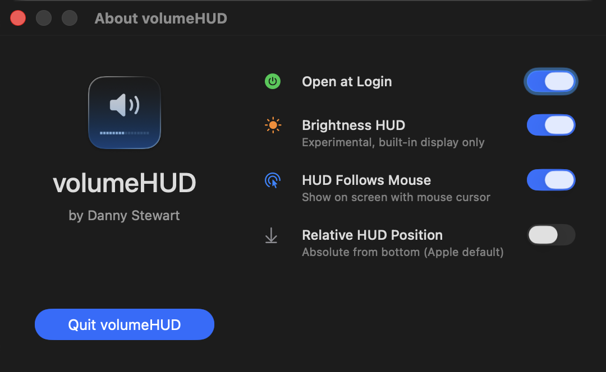

# classicHUD

A simple macOS app that brings back the classic volume and brightness HUDs.

**classicHUD is a personal fork of [volumeHUD](https://github.com/dannystewart/volumeHUD) by Danny Stewart.** It was renamed because it brings back the classic brightness HUD as well as the volume one. Credit for the original app goes to Danny; the prose below is largely his.

## Why This Exists

With macOS Tahoe, Apple revamped Control Center and replaced the classic volume and brightness indicators of 25 years with tiny popovers in the corner of the screen, even smaller than notifications. They're hard to see, especially against light backgrounds, and they disappear before I remember where to look. Even after months on the Tahoe beta I haven't gotten used to them. It's bad UI.

So I did what any sane person would do: I picked up Xcode and wrote my first ever Mac app to bring back the classic macOS HUDs we all know and love (except Apple, apparently). They do what any good system indicator should do: they show you the level when you change it and then they go away. And get this—you can actually *see them*. A groundbreaking feature in 2025.

## What It Looks Like

</img>

## Usage

Just launch the app! You should see a notification that it started, and you can begin enjoying your new (old) volume HUD right away. If you launch the app a second time, you'll get a window where you can set it to open at login, configure HUD preferences, and quit. It will also show when an update is available.

</img>

As of version 2.0, classicHUD supports brightness. It is **off by default**, and it is **experimental and unsupported**. It will only work for built-in displays, and it may not be bulletproof for automatic changes like power source or ambient light, though it does mostly catch these.

As of version 3.0, **classicHUD hides the system HUD**. It does this by intercepting the volume/brightness keys and handling volume/brightness changes directly, instead of having the OS do it. There is a safety check: if the app can't change the volume, mute state, or brightness after you press a key, or brightness doesn't actually change, it stops intercepting those keys until the audio device or display configuration changes or the app restarts. If nothing had changed yet, that key press goes to macOS as usual. Some devices accept a volume change without it taking effect, and the app can't detect that, since uneven hardware volume steps look the same. This keeps the keys working in most cases where interception fails on your system. Brightness keys are only intercepted while the brightness HUD is turned on.

## Installation

This fork has no Homebrew tap or prebuilt release. Build it from source with Xcode:

```bash
xcodebuild -project classicHUD.xcodeproj -scheme classicHUD -configuration Release build
```

Then copy `classicHUD.app` from the build products folder into `/Applications`. To uninstall, open the app a second time to show its settings window, turn off **Open at Login**, click **Quit classicHUD**, and delete `classicHUD.app`.

## Permissions

I worked hard to ensure the app could function without requiring any permissions. It will request two that are **optional but recommended**.

- **Notifications** are used only to confirm the app has started (and only when launched manually, not as a login item). Feel free to disable if you find them unnecessary.
- **Accessibility** is needed for full functionality. The app will work without it, but you lose some features:
  - The system HUD will still appear alongside classicHUD. Once you grant Accessibility, interception starts within a second or two, without restarting the app.
  - The HUD won't appear if you go below 0% or above 100% since it can't use key presses to determine if levels should have changed.
  - Brightness checks may be less reliable since key timing can't be used to check whether a change is user-initiated.

Apart from that, all other features should work.

## Troubleshooting

If you're experiencing inconsistent behavior, the most likely cause is lack of Accessibility permissions, and the first thing I would recommend is a full reset. The most thorough way to do this is to uninstall and reinstall:

1. Open classicHUD a second time to show its settings window, turn off **Open at Login** if you enabled it, and click **Quit classicHUD**. You can also run `pkill -f classicHUD`.
2. Open **System Settings** → **Privacy & Security** → **Accessibility**.
3. Find **classicHUD** in the list, select it, and click the minus (-) button at the bottom. Make sure it's removed from the list.
4. Delete **classicHUD.app**.
5. Reinstall the app as described under Installation.
6. Reopen **classicHUD.app**. You should be prompted for Accessibility permissions.
7. Open **System Settings** like it says to do, make sure **classicHUD** is in the list now, and toggle it on. If it says you'll need to quit and reopen, do that and try again.

Alternatively, you can do the same reset from the command line:

```bash
pkill -f classicHUD
tccutil reset Accessibility com.privatecoder.classichud
tccutil reset ListenEvent com.privatecoder.classichud
```

Then run the app again, grant the requested permissions, and triple-check everything in **System Settings**.

## License

This project is open source under the [MIT License](./LICENSE). You're free to do what you want with it, but credit would be appreciated.

<a href="https://www.buymeacoffee.com/dannystewart" target="_blank"></a>
